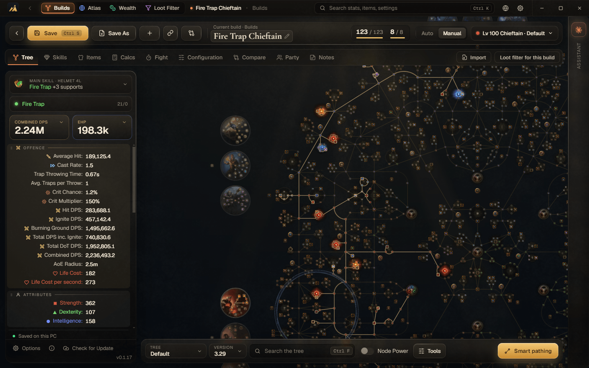
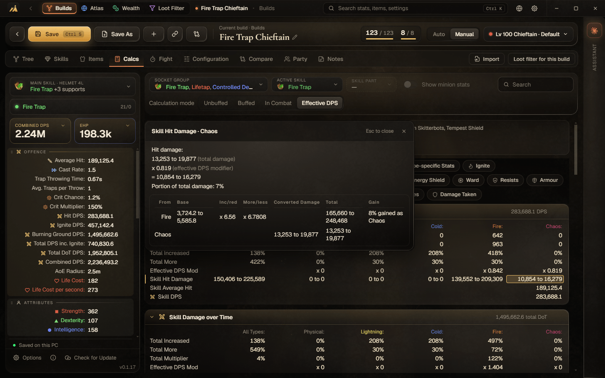
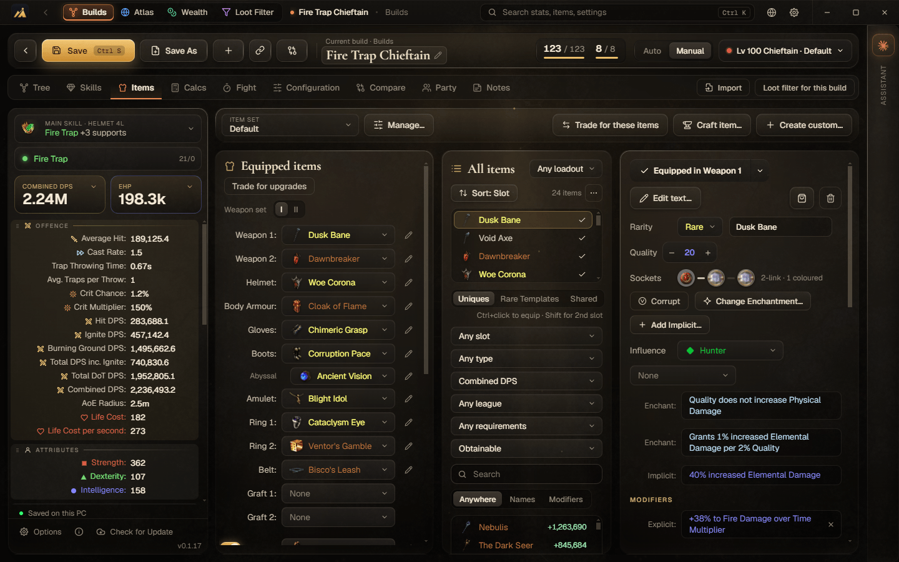
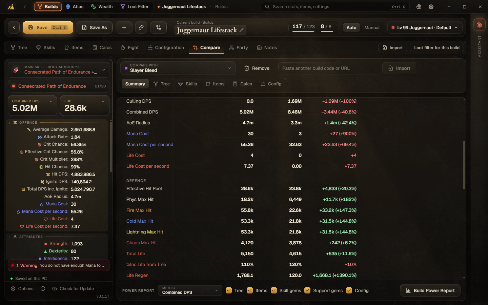
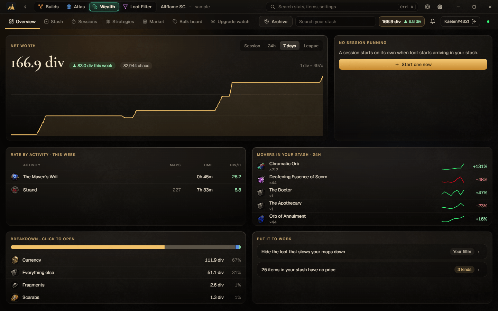
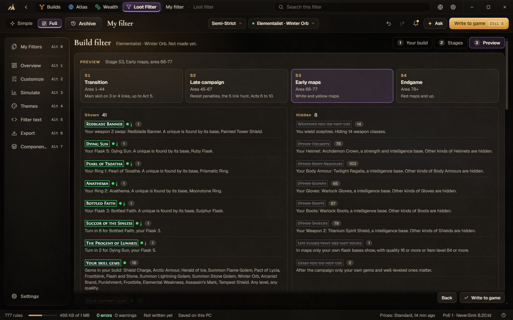
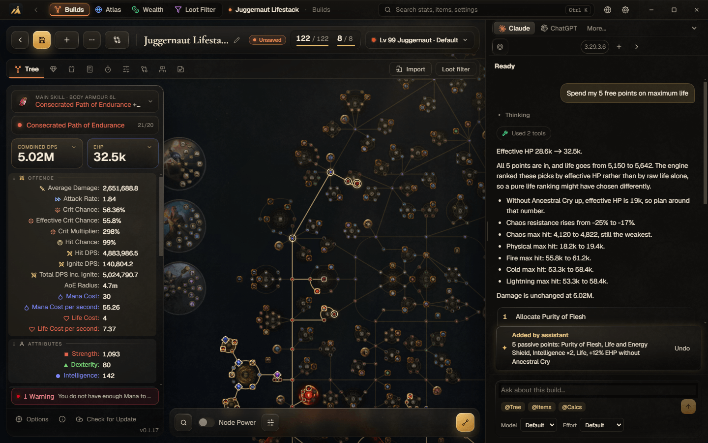

# Path of Mastery

A free, open-source build planner for Path of Exile 1, for Windows. It has its own calculation engine written in Rust and an AI assistant that edits your build. It also makes loot filters and tracks wealth.



## Download

The newest installer is on the [releases page](https://github.com/aaronlilla/pathofmastery-releases/releases/latest). Planning and calculating builds needs no account. The AI features need a Discord sign-in.

## What it does

- Tree, skills, items and config for each build, calculated by the Rust engine.
- A Calcs tab that shows how every number is made up.
- Imports build codes and links from pobb.in, poe.ninja and Pastebin.
- Compares two builds.
- Tracks wealth and prices.
- Builds loot filters on top of the NeverSink filters.
- An AI assistant that works on the build you have open.







## The AI assistant

The assistant runs on your own Claude (Claude Code) or ChatGPT (Codex) subscription, through those command-line tools. The app serves the open build over a local MCP server called `path-of-mastery`, so Claude Desktop can use it too. A change the assistant makes goes into the build live as one Undo step, and the changed parts are highlighted.



The AI features need a Discord sign-in. The hosted service checks each request.

## Build from source

You need Windows, Git, Node 20 or newer, Rust (stable, through rustup) and Visual Studio Build Tools with the "Desktop development with C++" workload. The engine pulls in a C dependency, so the C++ tools are required.

```
git clone https://github.com/aaronlilla/path-of-mastery.git
cd path-of-mastery
npm ci
cargo build -p pom-napi --release
cd apps/desktop
node scripts/stage-engine.mjs
npm run dev
```

The release profile uses thin LTO and one codegen unit, so the first engine build is slow. `npm run dev` does not stage the engine itself, so run `stage-engine.mjs` before it.

`npm run package` builds an unsigned installer into `apps/desktop/release`. Copies you build yourself do not auto-update.

Copies you build yourself have no account features (sign-in, cloud saves, sharing). The planner and the assistant work locally.

## Layout

- `apps/desktop`: the Electron and React app (main process, renderer, preload, engine host, MCP bridge)
- `crates`: the calculation engine and the Node addon the app loads
- `engine-data`: the game data the engine reads
- `packages`: contracts shared by the app and its tools
- `resources`: atlas data and starter builds that ship with the app
- `tools/mastery-starters`: the starter build chooser the app bundles

## Licence

MIT, see `LICENSE`. The code and data this builds on are credited in `THIRD-PARTY-NOTICES.md`. Bugs and ideas go in [GitHub Issues](https://github.com/aaronlilla/path-of-mastery/issues).
